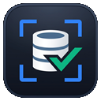

<p align="center">
  
</p>

<h1 align="center">VarSQL</h1>

<p align="center">
  <strong>Estudio Relacional Auditado, Visual y Didáctico para Bases de Datos SQL</strong><br />
  <em>Inspirado en el VAR (Video Assistant Referee): revisa cada decisión de tu esquema y cada consulta antes de tocar el disco.</em>
</p>

<p align="center">
  
  
  
  
</p>

---

## ¿Qué es VarSQL?

**VarSQL** es una aplicación de escritorio open-source, ligera y **100 % determinista (offline, sin APIs externas ni alucinaciones)** para diseñar, auditar, desplegar, explorar y consultar bases de datos relacionales SQL.

Combina el rigor de un motor SQL real (SQLite local) con una **sala de revisión visual (VAR)** que detecta errores de modelado y bloquea sentencias destructivas antes de que causen pérdida de datos.

## Características principales

* **Motor Determinista Texto → Esquema (Español):** transforma descripciones en español libre o especificaciones técnicas estructuradas en un *Contrato Maestro JSON* con entidades, tipos semánticos (`DECIMAL(10,2)`, `DATE`, `BOOLEAN`, `VARCHAR UNIQUE`), claves primarias simples/compuestas, columnas calculadas y relaciones `1:1`, `1:N` y `N:M`.
* **Lienzo ER Interactivo + Undo/Redo (`Ctrl+Z` / `Ctrl+Y`):** arrastre de nodos, edición inline, vinculación visual de claves foráneas y confirmación *Human-in-the-Loop* antes de materializar en disco.
* **Diagrama Relacional Académico:** notación **Conceptual (Chen)** (entidades, rombos editables, atributos PK/UK/derivados) y **Paso a Tablas (Claves)** con exportación vectorial **SVG** y **PNG** en alta resolución.
* **Auditor VAR Proactivo + Escudo Anti-Desastres:**
  * Detecta tablas sin PK, violaciones de 1ª Forma Normal (columnas repetitivas o multivaluadas), importes en `FLOAT`, fechas en texto, `ON DELETE CASCADE` peligroso en tablas históricas y claves foráneas sin índice, con **corrección automática en 1 clic**.
  * Intercepta `UPDATE`/`DELETE` sin `WHERE` (incluyendo `WITH ... DELETE` y condiciones triviales `OR 1=1`) y `DROP TABLE`, cuantificando filas afectadas y dependencias FK antes de ejecutar.
* **Migraciones SQLite Reales:** soporta evolución de esquemas con preservación de datos mediante reconstrucción transaccional de tablas (`RENAME → CREATE → INSERT SELECT → DROP`).
* **Explorador de Datos Relacional:** cuadrícula paginada editable con soporte de **PK compuestas**, previsualización flotante de registros padre en celdas `FK`, estilos `NULL` y exportación a **CSV, JSON y SQL (`INSERT`)**.
* **Editor SQL Dual Multi-Dialecto:** sincronización bidireccional **DDL ↔ Lienzo ER** con transpilación a **SQLite, MySQL, PostgreSQL y SQL Server**, consultas DML paginadas, análisis `EXPLAIN QUERY PLAN` con creación de índices en 1 clic y autocompletado inteligente.
* **Modo Tutor vs. Modo Estándar:** tarjetas pedagógicas vivas sobre tu propio esquema, desglosador paso a paso del orden lógico de ejecución SQL, visualizador de conjuntos `INNER` / `LEFT` / `RIGHT` / `FULL` / `CROSS JOIN` y retos guiados.
* **Interfaz Dual Profesional:** **Tema Oscuro (Sala VOR)** y **Tema Claro (Laboratorio)** con barra de estado tipo IDE y persistencia de preferencias.

---

## Estructura del proyecto

```text
VarSQL/
├── assets/                 # Icono multi-resolución oficial (varsql.ico)
├── backend/
│   ├── api/                # Endpoints REST (FastAPI + validación Pydantic)
│   └── core/               # Motor determinista (NLP, Auditor, Transpilador, SQLite, Tutor)
├── docs/                   # Especificación de producto (PRODUCT.md) y diseño (DESIGN.md)
├── frontend/               # Interfaz modular (HTML5, CSS3, ES Modules, SVG)
│   └── modules/            # Core, Undo/Redo y utilidades de exportación
├── installer/              # Script de instalador Windows (Inno Setup 6: VarSQL.iss)
├── tests/                  # Suite de pruebas automatizadas (unittest / pytest)
├── workspaces/             # Carpeta local de bases de datos .db (ignorada en Git)
├── run.py                  # Punto de entrada unificado (escritorio nativo + --web)
├── VarSQL.spec             # Configuración de compilación PyInstaller
└── requirements.txt        # Dependencias Python
```

---

## Descargar e instalar (Windows)

Descarga el instalador oficial de Windows desde **GitHub Releases** (no requiere Python instalado):

<p>
  <a href="https://github.com/hinostrozaralex-ship-it/VarSQL/releases/download/v1.4.0/Setup-VarSQL-1.4.0.exe">
    
  </a>
</p>

1. Haz clic en el botón superior para descargar **`Setup-VarSQL-1.4.0.exe`** (o visita la página de [Releases](https://github.com/hinostrozaralex-ship-it/VarSQL/releases/latest)).
2. Ejecuta el instalador y sigue el asistente.
3. Abre **VarSQL** desde el menú Inicio o el acceso directo del escritorio.

---

## Instalación y uso desde código fuente

### 1. Clonar e instalar dependencias

```bash
git clone https://github.com/hinostrozaralex-ship-it/VarSQL.git
cd VarSQL
python -m venv .venv
.venv\Scripts\activate
pip install -r requirements.txt
```

### 2. Ejecutar la aplicación

```bash
# Modo aplicación de escritorio nativa (Windows WebView2)
python run.py

# Modo servidor web local opcional
python run.py --web
```

### 3. Ejecutar los tests automatizados

```bash
python -m unittest discover -s tests -v
```

---

## Compilar ejecutable e instalador de Windows

```bash
# 1. Generar ejecutable nativo en dist/VarSQL/VarSQL.exe
python -m PyInstaller --noconfirm --clean VarSQL.spec

# 2. (Opcional) Generar instalador único Setup-VarSQL-1.4.0.exe con Inno Setup 6
iscc installer\VarSQL.iss
```

---

## Documentación y contribuciones

* [Especificación de Producto](docs/PRODUCT.md)
* [Sistema de Diseño](docs/DESIGN.md)
* [Guía de Contribución](CONTRIBUTING.md)
* [Historial de Cambios](CHANGELOG.md)

## Licencia

Distribuido bajo licencia **MIT**. Consulta el archivo [LICENSE](LICENSE) para más información.
